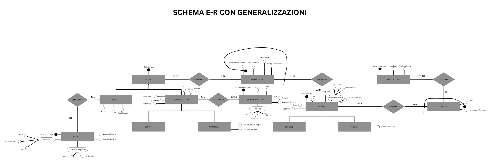
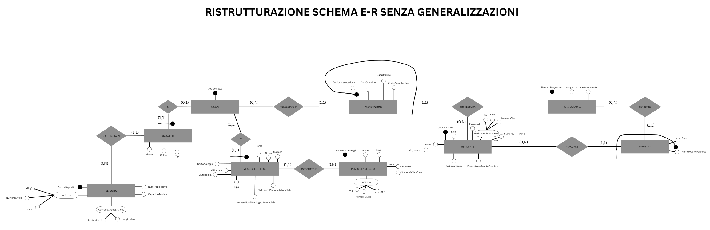
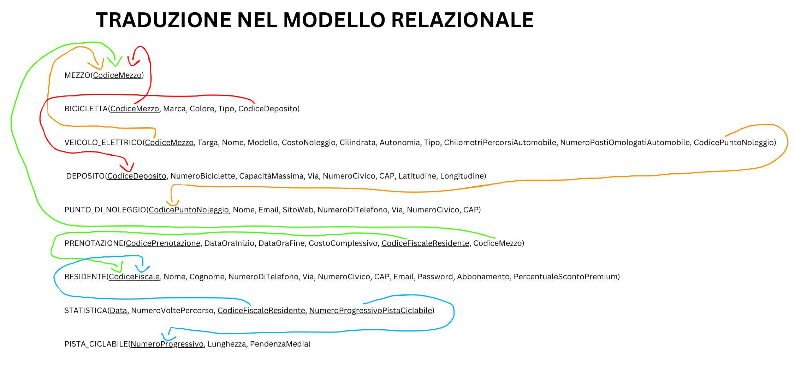
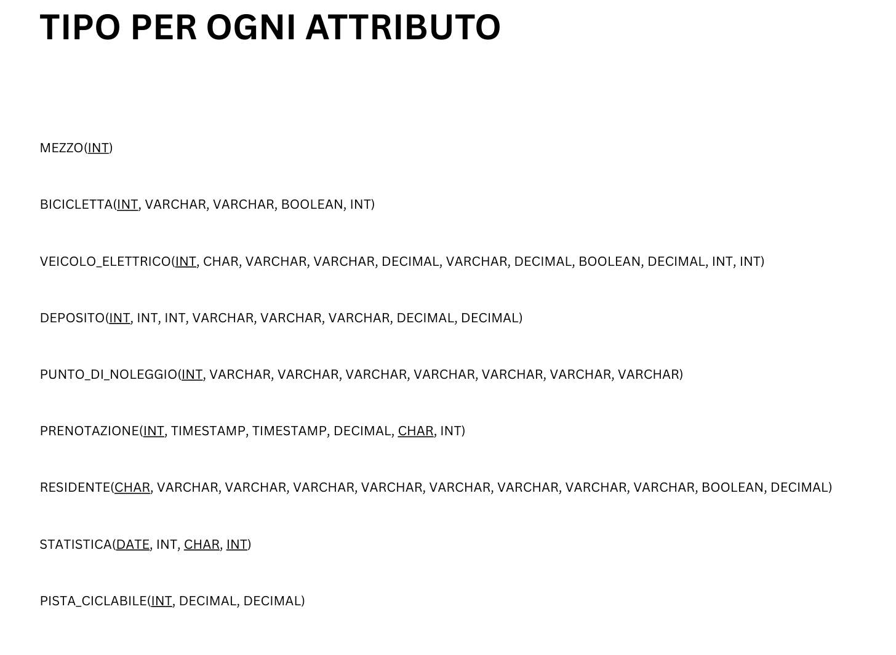

# Urban Sustainable Mobility Database (Milan)

<div align="center">

### Select Language / Seleziona Lingua
<a href="#en">
  
</a>
&nbsp;&nbsp;&nbsp;&nbsp;
<a href="#it">
  
</a>

</div>

---

<a id="en"></a>
##  Project Overview

Relational database system designed to model and manage the shared urban green mobility infrastructure for the Municipality of Milan (*Comune di Milano*). The system coordinates docked municipal bicycles (both traditional and pedal-assisted), electric vehicle rental fleets (cars and scooters), citizen subscription tiers, reservation lifecycles, and cycle route usage statistics.

Detailed functional requirements, domain constraints, and operational targets are documented in [`Docs/Requisiti_progetto.pdf`](Docs/Requisiti_progetto.pdf).


## Domain Entity Mapping

The physical database schema implements standard Italian domain naming. The table below maps internal relational tables to their English business concepts:

| Italian Table | English Concept | Description |
| :--- | :--- | :--- |
| `RESIDENTE` | Resident / User | Registered Milan citizens holding Standard or Premium accounts. |
| `MEZZO` | Base Vehicle | General vehicle superclass entity providing unique vehicle identification. |
| `BICICLETTA` | Bicycle | Docked bicycles categorized as traditional or pedal-assisted. |
| `VEICOLO_ELETTRICO` | Electric Vehicle | Motorized fleet subdivided into e-scooters and electric cars. |
| `DEPOSITO` | Bike Hub / Depot | Physical stations across Milan with maximum bicycle capacities. |
| `PUNTO_DI_NOLEGGIO` | EV Rental Station | Dedicated rental hubs where electric vehicles are stationed and managed. |
| `PRENOTAZIONE` | Reservation | Booking records linking a user to a vehicle with start/end timestamps. |
| `PISTA_CICLABILE` | Cycle Path / Bike Lane | Milan bike tracks monitored by ID, length, and average slope. |
| `STATISTICA` | Transit Record | Historical logs tracking resident transit frequency across cycle paths. |


## Conceptual & Logical Architecture

### 1. Conceptual E-R Model
The initial conceptual schema established three key generalization hierarchies ($ISA$):
* Base vehicle (`Mezzo`) specialized into `Bicicletta` and `Veicolo Elettrico`.
* `Veicolo Elettrico` specialized into `Scooter` and `Automobile`.
* `Residente` specialized into `Standard` and `Premium`.

> **Design Choice on Bicycles**: The `Bicicletta` entity does not require an $ISA$ generalization because traditional and pedal-assisted bicycles share identical attributes (brand, color, depot). The distinction is handled via a boolean discriminator `Tipo`.



### 2. Restructured E-R Model (Generalization Elimination)
To optimize physical schema performance and avoid expensive joins:
* **`Residente`**: Folded upwards into the parent table `RESIDENTE`. A boolean flag `Abbonamento` discriminates between Standard (`FALSE`) and Premium (`TRUE`) users, controlling the conditional discount attribute `PercentualeScontoPremium`.
* **`Veicolo Elettrico`**: Folded upwards into `VEICOLO_ELETTRICO`. The boolean flag `Tipo` discriminates between cars (`TRUE`) and scooters (`FALSE`), regulating car-exclusive metrics (`ChilometriPercorsiAutomobile`, `NumeroPostiOmologatiAutomobile`).
* **`Mezzo`**: Preserved as a distinct parent table with $(1,1) \leftrightarrow (0,1)$ relationships. Bicycles and electric vehicles belong to incompatible operational logistics (automated docking depots vs. staffed rental stations); keeping them physically distinct prevents structural null-bloat and preserves referential integrity.



### 3. Logical Relational Model
Primary keys are underlined; referential constraints are maintained across relations:

* `MEZZO` (<u>CodiceMezzo</u>)
* `BICICLETTA` (<u>CodiceMezzo</u>, Marca, Colore, Tipo, CodiceDeposito)
* `VEICOLO_ELETTRICO` (<u>CodiceMezzo</u>, Targa, Nome, Modello, CostoNoleggio, Cilindrata, Autonomia, Tipo, ChilometriPercorsiAutomobile, NumeroPostiOmologatiAutomobile, CodicePuntoNoleggio)
* `DEPOSITO` (<u>CodiceDeposito</u>, NumeroBiciclette, CapacitaMassima, Via, NumeroCivico, CAP, Latitudine, Longitudine)
* `PUNTO_DI_NOLEGGIO` (<u>CodicePuntoNoleggio</u>, Nome, Email, SitoWeb, NumeroDiTelefono, Via, NumeroCivico, CAP)
* `PRENOTAZIONE` (<u>CodicePrenotazione</u>, <u>CodiceFiscaleResidente</u>, DataOraInizio, DataOraFine, CostoComplessivo, CodiceMezzo)
* `RESIDENTE` (<u>CodiceFiscale</u>, Nome, Cognome, NumeroDiTelefono, Via, NumeroCivico, CAP, Email, Password, Abbonamento, PercentualeScontoPremium)
* `STATISTICA` (<u>Data</u>, <u>CodiceFiscaleResidente</u>, <u>NumeroProgressivoPistaCiclabile</u>, NumeroVoltePercorso)
* `PISTA_CICLABILE` (<u>NumeroProgressivo</u>, Lunghezza, PendenzaMedia)





## Business Rules & Integrity Constraints

* **Subscription Discount Coherence**: Standard accounts cannot have discounts, while Premium accounts must have a discount strictly between $0\%$ and $100\%$:
  ```sql
  CHECK ((Abbonamento = TRUE AND PercentualeScontoPremium BETWEEN 0 AND 100) OR 
         (Abbonamento = FALSE AND PercentualeScontoPremium IS NULL))
  ```

* **Vehicle Subtype Integrity**: Technical car attributes (seats, mileage) are strictly forbidden for scooters:
  ```sql
  CHECK ((Tipo = TRUE AND NumeroPostiOmologatiAutomobile > 0 AND ChilometriPercorsiAutomobile >= 0) OR 
         (Tipo = FALSE AND NumeroPostiOmologatiAutomobile IS NULL AND ChilometriPercorsiAutomobile IS NULL))
  ```

* **Depot Physical Capacity**: Bicycle counts cannot exceed maximum station capacity, and capacity must be positive:
  ```sql
  CapacitaMassima INTEGER NOT NULL CHECK (CapacitaMassima > 0),
  CHECK (NumeroBiciclette BETWEEN 0 AND CapacitaMassima)
  ```

* **Rental Timing & Free Pricing**: Enforces chronological coherence (`DataOraInizio < DataOraFine`). Bicycle reservations are free (`CostoComplessivo IS NULL`), whereas electric vehicle bookings require positive charges:
  ```sql
  CHECK (DataOraInizio < DataOraFine),
  CHECK ((CostoComplessivo IS NULL) OR (CostoComplessivo > 0))
  ```

* **Referential Cleanup Policies (`ON DELETE`)**:
  * `CASCADE` on `RESIDENTE`: User account deletion automatically purges associated bookings and transit records.
  * `NO ACTION` on `DEPOSITO` and `PUNTO_DI_NOLEGGIO`: Prevents accidental deletion of physical stations containing active vehicles.

The complete DDL implementation—comprising table creation, domain `CHECK` constraints, foreign keys, and seed data population—can be found in [`SQL/Struttura_e_popolamento.sql`](SQL/Struttura_e_popolamento.sql).


## Analytical Queries Showcase

### 1. Pedal-Assisted Bikes Booked by Premium Users
Finds all pedal-assisted bicycles (`Tipo = TRUE`) reserved by registered Premium citizens:
```sql
SELECT DISTINCT B.CodiceMezzo
FROM BICICLETTA B 
JOIN PRENOTAZIONE PR ON B.CodiceMezzo = PR.CodiceMezzo 
JOIN RESIDENTE R ON PR.CodiceFiscaleResidente = R.CodiceFiscale
WHERE B.Tipo = TRUE AND R.Abbonamento = TRUE;
```
**Output:**
| CodiceMezzo |
| :--- |
| `2` |
| `4` |

---

### 2. Top Spender on Electric Vehicles
Retrieves the resident(s) who accumulated the highest aggregate spending on electric vehicle rentals using the universal quantifier `>= ALL`:
```sql
SELECT PR1.CodiceFiscaleResidente, SUM(PR1.CostoComplessivo) AS TotalSpent
FROM PRENOTAZIONE PR1 
JOIN VEICOLO_ELETTRICO VE1 ON PR1.CodiceMezzo = VE1.CodiceMezzo 
GROUP BY PR1.CodiceFiscaleResidente
HAVING SUM(PR1.CostoComplessivo) >= ALL (
    SELECT SUM(PR2.CostoComplessivo)
    FROM PRENOTAZIONE PR2 
    JOIN VEICOLO_ELETTRICO VE2 ON PR2.CodiceMezzo = VE2.CodiceMezzo
    GROUP BY PR2.CodiceFiscaleResidente
);
```
**Output:**
| CodiceFiscaleResidente | TotalSpent |
| :--- | :--- |
| `VRDLGI90A01F205X` | 43.50 |

---

### 3. Fleet Utilization per Electric Car
Computes the count of unique registered citizens who rented each electric car (`Tipo = TRUE`), including vehicles with zero bookings via `RIGHT JOIN`:
```sql
SELECT VE.CodiceMezzo, COUNT(DISTINCT PR.CodiceFiscaleResidente) AS DistinctUsers
FROM PRENOTAZIONE PR 
RIGHT JOIN VEICOLO_ELETTRICO VE ON PR.CodiceMezzo = VE.CodiceMezzo
WHERE VE.Tipo = TRUE
GROUP BY VE.CodiceMezzo;
```
**Output Excerpt:**
| CodiceMezzo | DistinctUsers |
| :--- | :--- |
| `11` | 1 |
| `12` | 1 |
| `13` | 1 |
| `14` | 1 |
| `15` | 1 |
| `21` | 1 |
| `22` | 1 |
| `23`–`30`, `41`–`43`, `49`–`50` | 0 |

The full suite of analytical queries, aggregation logic, and reporting statements is available in [`SQL/Interrogazioni.sql`](SQL/Interrogazioni.sql).


<a id="it"></a>
##  Descrizione del Progetto

Progettazione concettuale, logica e fisica di una base di dati relazionale a supporto del servizio di mobilità sostenibile promosso dal **Comune di Milano**. 

Il sistema gestisce il parco biciclette condivise (tradizionali e a pedalata assistita), la flotta di veicoli elettrici a noleggio (scooter e automobili), i profili dei residenti con relative fasce di abbonamento agevolato, le prenotazioni e il monitoraggio statistico dei transiti sulle piste ciclabili cittadine.

La specifica completa dei requisiti operativi, il testo della traccia e gli obiettivi del Comune di Milano sono consultabili nel documento [`Docs/Requisiti_progetto.pdf`](Docs/Requisiti_progetto.pdf).


## Mappatura delle Entità di Dominio

Di seguito viene riportata la mappatura concettuale tra le tabelle relazionali implementate nella base di dati e i relativi requisiti di business:

| Tabella Relazionale | Descrizione e Ruolo nello Schema |
| :--- | :--- |
| `RESIDENTE` | Residenti del Comune di Milano registrati al servizio, suddivisi nelle categorie *Standard* e *Premium* (questi ultimi con diritto a percentuali di sconto sui noleggi). |
| `MEZZO` | Entità padre astratta che garantisce un codice identificativo univoco (`CodiceMezzo`) a tutti i veicoli della flotta comunale. |
| `BICICLETTA` | Biciclette (sia tradizionali che a pedalata assistita) distribuite nei depositi territoriali, fruibili gratuitamente dai residenti registrati. |
| `VEICOLO_ELETTRICO` | Flotta a motore a tariffazione oraria (scooter e automobili), descritta da autonomia, targa, cilindrata e punto di noleggio di assegnazione. |
| `DEPOSITO` | Stazioni fisiche diffuse in città, georeferenziate tramite coordinate (latitudine e longitudine), dotate di capienza massima e conteggio bici presenti. |
| `PUNTO_DI_NOLEGGIO` | Hub fisici presidiati con recapiti di contatto (telefono, email, sito web) a cui sono associati in modo univoco i veicoli elettrici. |
| `PRENOTAZIONE` | Registrazione dell'evento di noleggio che associa un utente a un mezzo, definendo data/ora di inizio, data/ora di fine e l'eventuale costo complessivo. |
| `PISTA_CICLABILE` | Tracciati ciclabili comunali censiti tramite identificativo progressivo, lunghezza chilometrica e pendenza media. |
| `STATISTICA` | Entità di collegamento per raccogliere dati aggregati a fini statistici: memorizza per ogni residente e per ogni pista le date e la frequenza di passaggio. |


## Architettura e Scelte di Progettazione

### 1. Schema E-R Concettuale (con Generalizzazioni)
Durante la prima fase di modellazione sono state formalizzate tre gerarchie di generalizzazione ($ISA$):
* `Mezzo` (Padre) specializzato nelle figlie `Bicicletta` e `Veicolo Elettrico`.
* `Veicolo Elettrico` (Padre) specializzato nelle figlie `Scooter` e `Automobile`.
* `Residente` (Padre) specializzato nelle figlie `Standard` e `Premium`.

> **Nota su `Bicicletta`**: Per l'entità bicicletta non è stata introdotta una generalizzazione formale in quanto i modelli tradizionali e a pedalata assistita condividono i medesimi attributi (marca, colore, deposito). La distinzione è mantenuta in modo pulito tramite l'attributo discriminatore booleano `Tipo`.


### 2. Ristrutturazione Schema E-R (Eliminazione Generalizzazioni)
Per ottimizzare le prestazioni fisiche su DBMS ed evitare operazioni di join ridondanti:
* **Generalizzazione `Residente`** $\to$ **Accorpamento delle figlie nel padre**: Le due tipologie di utente condividono l'anagrafica e i contatti. Confluiscono nella tabella padre `RESIDENTE` con l'attributo discriminatore `Abbonamento` (`BOOLEAN`: `TRUE = Premium`, `FALSE = Standard`) e l'attributo condizionato `PercentualeScontoPremium`.
* **Generalizzazione `Veicolo Elettrico`** $\to$ **Accorpamento delle figlie nel padre**: Scooter e automobili confluiscono in `VEICOLO_ELETTRICO`. La discriminante `Tipo` (`TRUE = Automobile`, `FALSE = Scooter`) regola la valorizzazione obbligatoria dei dati esclusivi delle auto (`NumeroPostiOmologatiAutomobile`, `ChilometriPercorsiAutomobile`).
* **Generalizzazione `Mezzo`** $\to$ **Mantenimento delle entità con relazioni (1,1) - (0,1)**: L'entità padre `MEZZO` è mantenuta separata e collegata alle figlie `BICICLETTA` e `VEICOLO_ELETTRICO`. Dal lato delle figlie la cardinalità è $(1,1)$, mentre dal lato padre è $(0,1)$ poiché la copertura è esclusiva (un mezzo non può essere contemporaneamente sia bicicletta che auto/scooter). La separazione fisica è necessaria perché le due categorie rispondono a modelli logistici incompatibili (depositi automatizzati per biciclette vs stazioni presidiate per veicoli a motore).


### 3. Traduzione nel Modello Relazionale
Rappresentazione del modello logico con identificazione delle chiavi primarie (sottolineate) e delle chiavi esterne:

* `MEZZO` (<u>CodiceMezzo</u>)
* `BICICLETTA` (<u>CodiceMezzo</u>, Marca, Colore, Tipo, CodiceDeposito)
* `VEICOLO_ELETTRICO` (<u>CodiceMezzo</u>, Targa, Nome, Modello, CostoNoleggio, Cilindrata, Autonomia, Tipo, ChilometriPercorsiAutomobile, NumeroPostiOmologatiAutomobile, CodicePuntoNoleggio)
* `DEPOSITO` (<u>CodiceDeposito</u>, NumeroBiciclette, CapacitaMassima, Via, NumeroCivico, CAP, Latitudine, Longitudine)
* `PUNTO_DI_NOLEGGIO` (<u>CodicePuntoNoleggio</u>, Nome, Email, SitoWeb, NumeroDiTelefono, Via, NumeroCivico, CAP)
* `PRENOTAZIONE` (<u>CodicePrenotazione</u>, <u>CodiceFiscaleResidente</u>, DataOraInizio, DataOraFine, CostoComplessivo, CodiceMezzo)
* `RESIDENTE` (<u>CodiceFiscale</u>, Nome, Cognome, NumeroDiTelefono, Via, NumeroCivico, CAP, Email, Password, Abbonamento, PercentualeScontoPremium)
* `STATISTICA` (<u>Data</u>, <u>CodiceFiscaleResidente</u>, <u>NumeroProgressivoPistaCiclabile</u>, NumeroVoltePercorso)
* `PISTA_CICLABILE` (<u>NumeroProgressivo</u>, Lunghezza, PendenzaMedia)


## Vincoli di Integrità e Regole di Business

Tutti i requisiti operativi sono formalizzati tramite vincoli SQL espliciti nel DDL:

* **Coerenza Sconto Residenti**: Un utente Standard non può avere percentuali di sconto; un utente Premium deve avere un valore compreso tra 0 e 100:
  ```sql
  CHECK ((Abbonamento = TRUE AND PercentualeScontoPremium BETWEEN 0 AND 100) OR 
         (Abbonamento = FALSE AND PercentualeScontoPremium IS NULL))
  ```

* **Consistenza Parco Auto**: Posti omologati e chilometraggio sono consentiti e obbligatori solo per le automobili (`Tipo = TRUE`):
  ```sql
  CHECK ((Tipo = TRUE AND NumeroPostiOmologatiAutomobile > 0 AND ChilometriPercorsiAutomobile >= 0) OR 
         (Tipo = FALSE AND NumeroPostiOmologatiAutomobile IS NULL AND ChilometriPercorsiAutomobile IS NULL))
  ```

* **Capacità Massima Depositi**: Il conteggio delle biciclette presenti non può eccedere la capienza massima autorizzata del deposito:
  ```sql
  CapacitaMassima INTEGER NOT NULL CHECK (CapacitaMassima > 0),
  CHECK (NumeroBiciclette BETWEEN 0 AND CapacitaMassima)
  ```

* **Date e Gratuità Noleggi**: La data/ora di inizio deve precedere il termine. Per policy le biciclette sono a fruizione gratuita (`CostoComplessivo IS NULL`), mentre per i veicoli a motore il costo deve essere maggiore di zero:
  ```sql
  CHECK (DataOraInizio < DataOraFine),
  CHECK ((CostoComplessivo IS NULL) OR (CostoComplessivo > 0))
  ```

* **Politiche Referenziali (`ON DELETE`)**:
  * `CASCADE` su `RESIDENTE`: Rimuovendo un cittadino, le relative prenotazioni e statistiche d'uso vengono eliminate a cascata per garantire la consistenza referenziale.
  * `NO ACTION` su `DEPOSITO` e `PUNTO_DI_NOLEGGIO`: Impedisce l'eliminazione fisica di stazioni o depositi qualora vi siano ancora mezzi o biciclette ad essi assegnati.

Lo script DDL completo con la definizione di tutte le tabelle, i vincoli `CHECK`, le chiavi primarie/esterne e il popolamento con i dati di test è disponibile nel file [`SQL/Struttura_e_popolamento.sql`](SQL/Struttura_e_popolamento.sql).


## Interrogazioni SQL di Esempio

### 1. Bici a Pedalata Assistita Prenotate da Utenti Premium
Estrae tutte le biciclette a pedalata assistita (`Tipo = TRUE`) prenotate da residenti con abbonamento Premium:
```sql
SELECT DISTINCT B.CodiceMezzo
FROM BICICLETTA B 
JOIN PRENOTAZIONE PR ON B.CodiceMezzo = PR.CodiceMezzo 
JOIN RESIDENTE R ON PR.CodiceFiscaleResidente = R.CodiceFiscale
WHERE B.Tipo = TRUE AND R.Abbonamento = TRUE;
```
**Risultato:**
| CodiceMezzo |
| :--- |
| `2` |
| `4` |

---

### 2. Residente con Spesa Massima per Veicoli Elettrici
Calcola la spesa totale per residente sui veicoli elettrici ed estrae il massimo tramite il quantificatore universale `>= ALL`:
```sql
SELECT PR1.CodiceFiscaleResidente, SUM(PR1.CostoComplessivo) AS SpesaTotale
FROM PRENOTAZIONE PR1 
JOIN VEICOLO_ELETTRICO VE1 ON PR1.CodiceMezzo = VE1.CodiceMezzo 
GROUP BY PR1.CodiceFiscaleResidente
HAVING SUM(PR1.CostoComplessivo) >= ALL (
    SELECT SUM(PR2.CostoComplessivo)
    FROM PRENOTAZIONE PR2 
    JOIN VEICOLO_ELETTRICO VE2 ON PR2.CodiceMezzo = VE2.CodiceMezzo
    GROUP BY PR2.CodiceFiscaleResidente
);
```
**Risultato:**
| CodiceFiscaleResidente | SpesaTotale |
| :--- | :--- |
| `VRDLGI90A01F205X` | 43.50 |

---

### 3. Numero di Utenti Distinti per Automobile Elettrica
Visualizza per ciascuna automobile elettrica (`Tipo = TRUE`) il numero di utenti distinti che l'hanno prenotata, includendo le auto a zero noleggi tramite `RIGHT JOIN`:
```sql
SELECT VE.CodiceMezzo, COUNT(DISTINCT PR.CodiceFiscaleResidente) AS UtentiDistinti
FROM PRENOTAZIONE PR 
RIGHT JOIN VEICOLO_ELETTRICO VE ON PR.CodiceMezzo = VE.CodiceMezzo
WHERE VE.Tipo = TRUE
GROUP BY VE.CodiceMezzo;
```
**Estratto del Risultato:**
| CodiceMezzo | UtentiDistinti |
| :--- | :--- |
| `11` | 1 |
| `12` | 1 |
| `13` | 1 |
| `14` | 1 |
| `15` | 1 |
| `21` | 1 |
| `22` | 1 |
| `23`–`30`, `41`–`43`, `49`–`50` | 0 |

L'elenco integrale di tutte le query di collaudo e di analisi statistica previste dalla specifica è consultabile ed eseguibile nel file [`SQL/Interrogazioni.sql`](SQL/Interrogazioni.sql).
